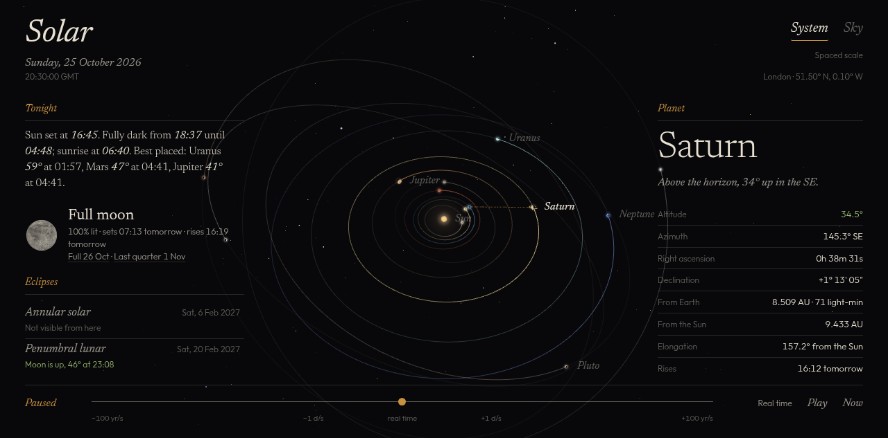
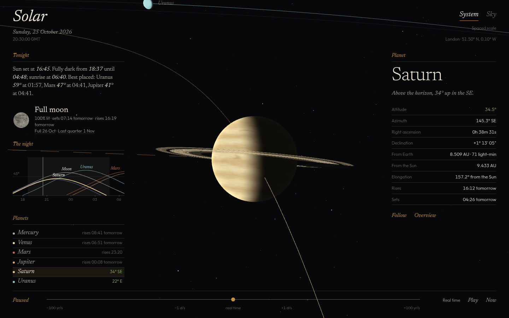
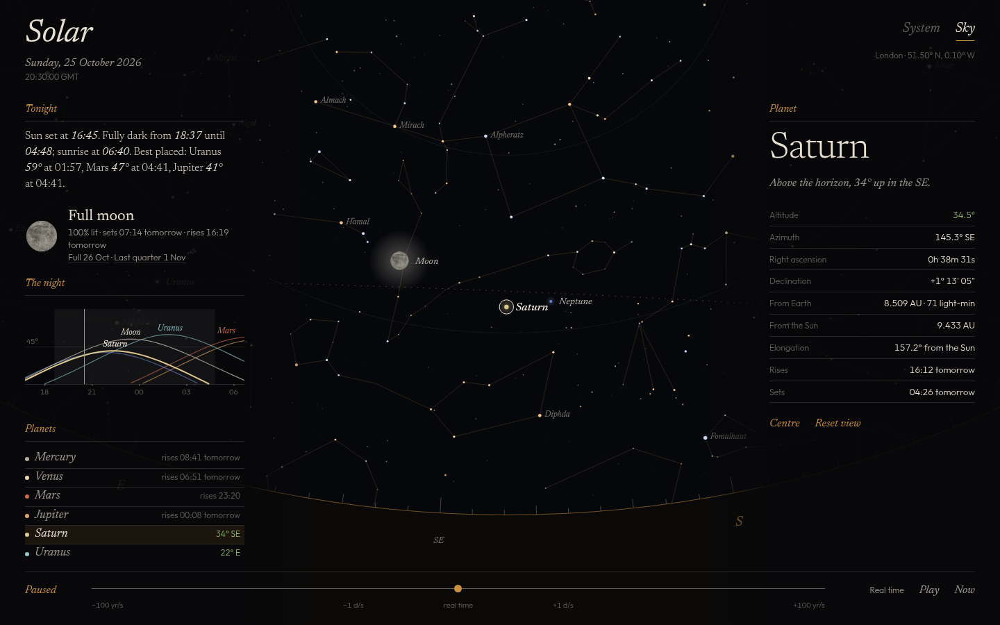
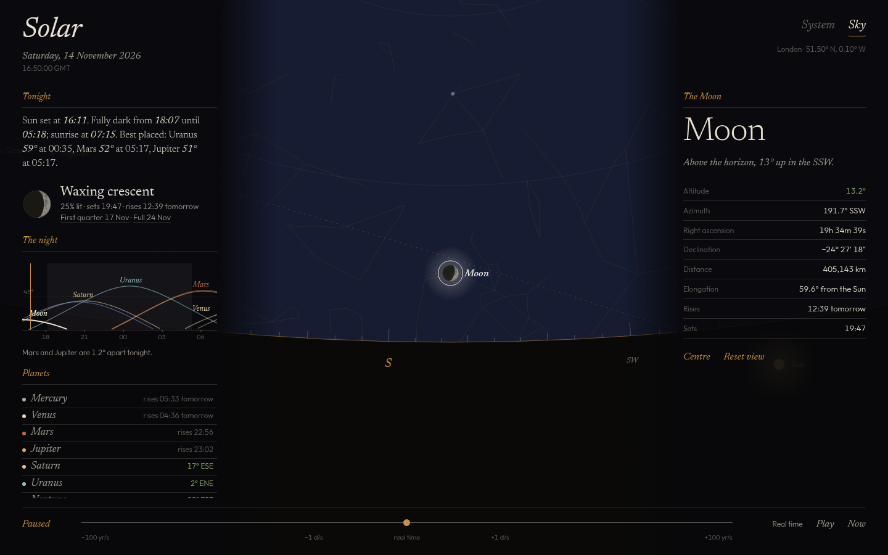
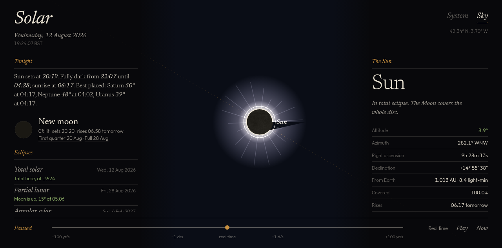
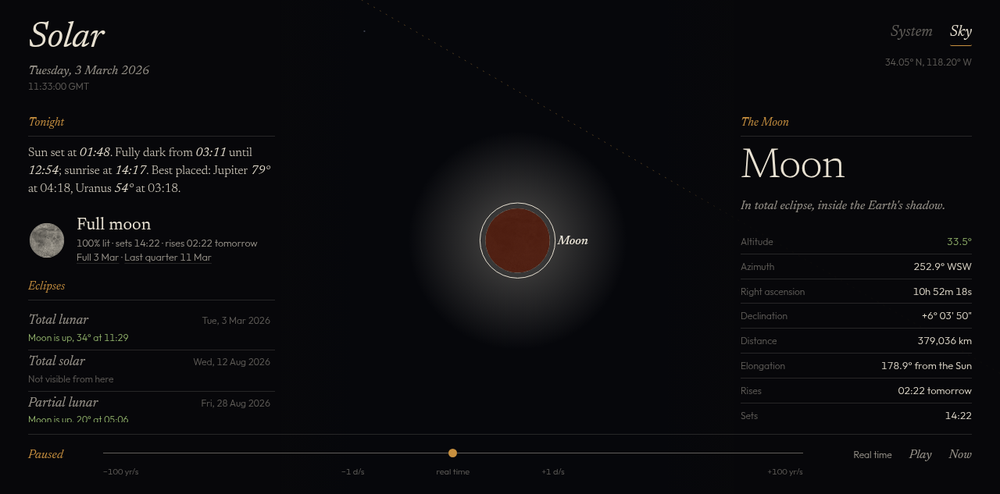
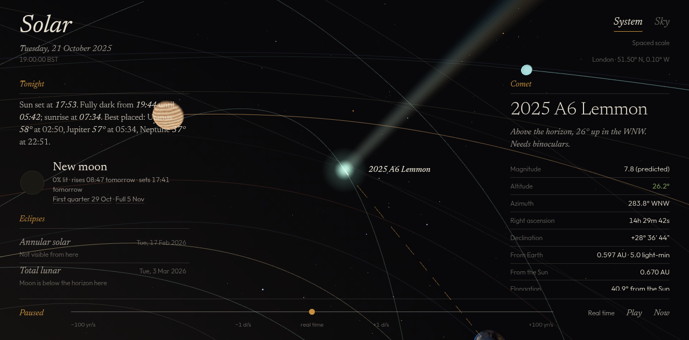

# Solar

A solar system you can look at from above, and a sky you can look at from the ground. Keplerian planet positions from JPL's elements, the Moon from a truncated Meeus series, and the real bright-star catalogue behind it all.



## Three ways in

**System** — the orrery. Procedural planet surfaces lit from the Sun, Earth with day and night lights at its real rotation, Saturn's rings with Cassini's gap and the planet's shadow, each planet tilted on its real pole. Orbits brighten behind each planet. Click anything to fly to it and follow it. *Spaced scale* compresses distance (∝ √AU) so Mercury isn't on top of the Sun; *True scale* is linear.



**Sky** — the view from where you stand. A draggable, zoomable dome with 2,300 real stars, constellation lines, named stars, the ecliptic, and the Sun, Moon and planets in place. The sky colour follows the Sun's altitude and the faintest visible star follows twilight. The Moon is drawn with its true phase and bright limb.





**Tonight** — the left column, always on: sunset, fully dark window and sunrise; the Moon's phase, rise and set and the next phases (click to jump there); what's up and when each planet rises; an altitude-against-time chart of the whole night; and any pair of bodies closer than 6°.

## Eclipses, dwarf planets, comets

**Eclipses.** The left column lists the next four, found by searching every new and full moon and classifying it from the real angular sizes of the Sun, Moon and Earth's shadow. Each says what *you* would see from your place (parallax included), e.g. "92% covered here at 19:08". Click one to jump to it in the sky view at true size: the Moon crosses the Sun, the sky darkens and a corona appears at totality; in a lunar eclipse the Earth's umbra and penumbra sweep across the Moon.





**Dwarf planets.** Ceres, Pluto, Haumea, Makemake and Eris, with faint orbits, in both views.

**Comets.** The brightest comets of 2025–2028 plus Halley and Encke, from JPL's Small-Body Database. Each shows an ion tail and a curved dust tail pointing away from the Sun, and a predicted magnitude. Most are faint today, so each has a *Brightest* button that jumps to its peak (try 2025 A6 Lemmon, October 2025). *Telescope objects* in the sky view's toggles shows everything down to magnitude 19.



## Time

Real time by default. The slider runs from 100 years/second backward to 100 years/second forward. Click the date to jump anywhere. `Now` snaps back.

## Place

Click the coordinates (top right) to set latitude and longitude. Saved in the browser. Clock times use the browser's time zone.

## URL parameters

`?t=2026-11-14T16:50:00Z` start time · `&paused=1` · `&mode=sky` · `&sel=Saturn` · `&speed=2` (slider step) · `&lat=51.5&lon=-0.1`

## Running

No build step. Serve the folder:

```bash
python3 serve.py 8965   # or any static server
```

On the Pi it runs as the user unit `solar.service` on port 8965.

## Files

| File | Purpose |
|---|---|
| `index.html`, `style.css` | Layout and type |
| `main.js` | Scene, clock, UI, camera |
| `planets.js` | Planet / Sun / ring / orbit / starfield shaders |
| `sky.js` | The stereographic sky dome (canvas 2D) |
| `tonight.js` | Twilight, rise/set, night tracks, close approaches |
| `moon.js` | Moon (full Meeus ch. 47) and Sun positions, phase, phase search |
| `eclipse.js` | Eclipse search, classification and local circumstances |
| `smallbodies.js` | Dwarf planets and comets: Kepler/hyperbolic/parabolic solvers, magnitudes |
| `elements.js`, `kepler.js`, `astronomy.js`, `horizon.js` | Orbital elements, solver, coordinates, altitude and horizon crossings |
| `serve.py` | Static server with no-cache headers |
| `assets/` | Fonts, star catalogue (`sky.json`), small bodies (`small.json`), Earth and Moon maps, three.js |

## Accuracy

Planets use JPL's approximate elements (J2000, 3000 BC – 3000 AD): arcminutes. The Moon uses the full Meeus series with topocentric parallax. Eclipses are right on type and date; timing runs a few minutes early (the Sun comes from JPL's approximate elements), so a local obscuration can be off by a few percent and an eclipse at the very edge of totality can flip between total and 99.9%. Rise and set ignore refraction. Dwarf planets and comets are two-body orbits from one epoch, and magnitudes are predictions from catalogue parameters, not observations. Coordinates are J2000 throughout, so alt/az is off by about 0.37° of precession.

## Credits

Orbital elements: [JPL SSD](https://ssd.jpl.nasa.gov/planets/approx_pos.html). Stars and constellation lines: [d3-celestial](https://github.com/ofrohn/d3-celestial) (Hipparcos-derived). Earth and Moon maps: three.js examples. Type: Newsreader and Outfit.
